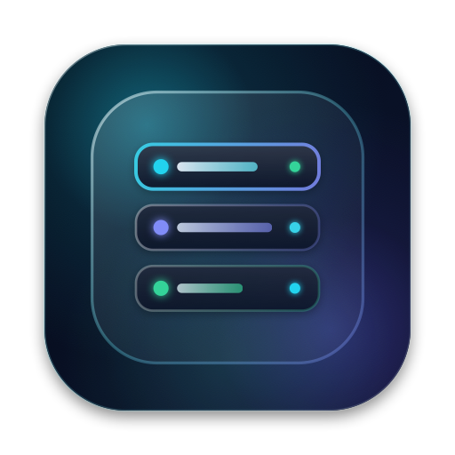
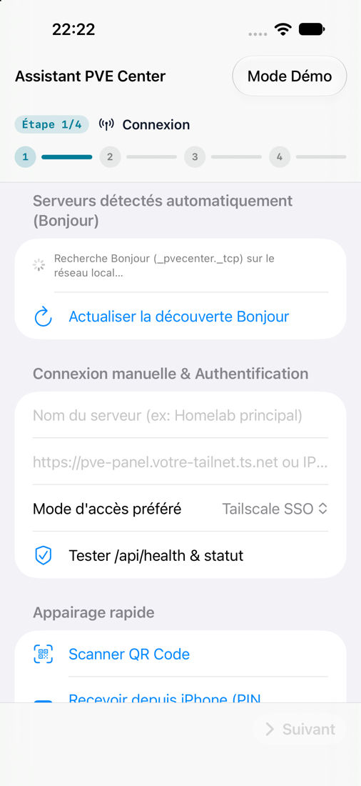
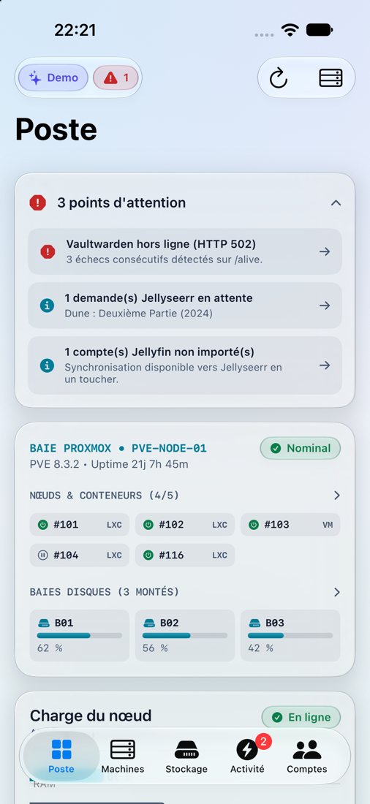
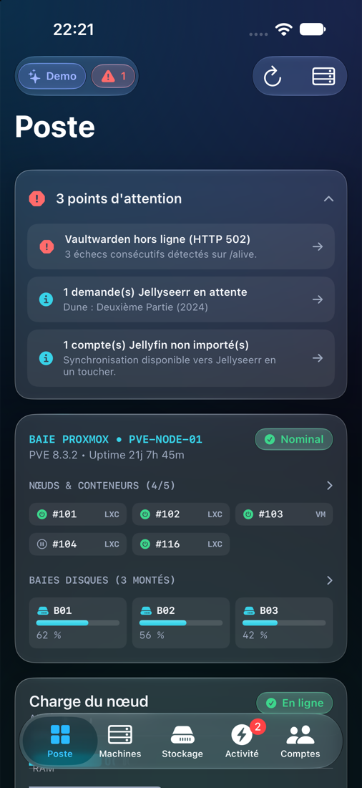
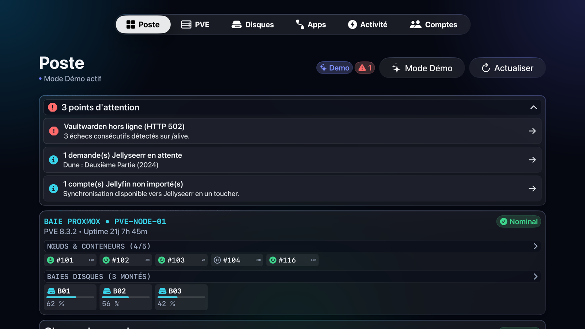
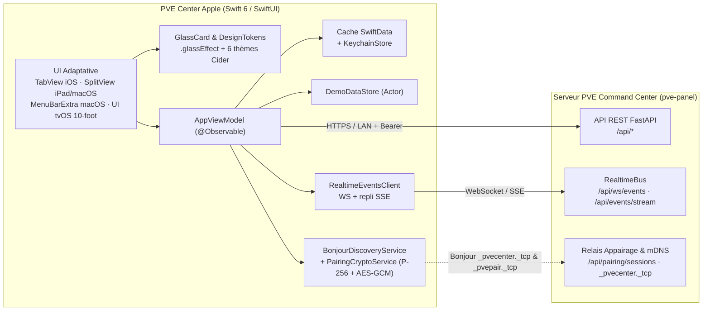

[English](README.md) | [Français](README.fr.md)

<div align="center">
  
  <h1>PVE Center pour Apple</h1>
  <p>
    <strong>Cockpit natif Swift 6 &amp; SwiftUI multi-plateformes pour Proxmox VE, services homelab, stockage SMART/MergerFS et alertes temps réel sur iPhone, iPad, Mac et Apple TV.</strong>
  </p>

  <p>
    
    
    <a href="LICENSE"></a>
    
    
  </p>

  <p>
    <a href="#points-forts">Points forts</a> &nbsp;·&nbsp;
    <a href="#captures-décran">Captures d'écran</a> &nbsp;·&nbsp;
    <a href="#thèmes-cider--liquid-glass">Thèmes Cider</a> &nbsp;·&nbsp;
    <a href="#aperçu-de-larchitecture">Architecture</a> &nbsp;·&nbsp;
    <a href="#compilation--installation">Compilation &amp; Installation</a> &nbsp;·&nbsp;
    <a href="#dépôts-compagnons">Écosystème</a>
  </p>
</div>

---

## Points forts

- **Projet Xcode universel unique (`PVECenter.xcodeproj`) & Package SwiftPM (`Package.swift`)** : base de code native en Swift 6 avec concurrence stricte (`io.ac.pvepanel.app`) ciblant **iPhone**, **iPad**, **Mac** (application macOS native, non « Designed for iPad ») et **Apple TV (`tvOS`)**.
- **Liquid Glass natif & Thèmes Cider Studio** : rendu reposant sur `.glassEffect(...)`, `.ultraThinMaterial`, halos ambiants dynamiques, gestion WCAG du contraste, modes d'accessibilité (`reduceTransparency` / contraste accru) et **6 thèmes d'accentuation Cider** en apparence Clair, Sombre ou Système.
- **Découverte zéro-config & Appairage Apple TV chiffré de bout en bout** :
  - Découverte **Bonjour / mDNS** locale via `Network.framework` (`_pvecenter._tcp` et scan LAN `_http._tcp`, `_ssh._tcp`, `_smb._tcp`).
  - **QR Code** et liens profonds `pvecenter://connect?...` (`AVCaptureSession` sur iOS).
  - **Appairage iPhone / Mac → Apple TV par PIN à 6 chiffres** : échange éphémère **CryptoKit P-256 ECDH** + dérivation **HKDF-SHA256** + chiffrement **AES-256-GCM** via Bonjour (`_pvepair._tcp`) ou le relais HTTPS (`/api/pairing/sessions`).
- **MenuBarExtra macOS & Raccourcis clavier** : menu persistant dans la barre des menus macOS affichant CPU/RAM du nœud Proxmox, pool MergerFS, débits qBittorrent + mode Tortue, flux Jellyfin actifs et raccourcis (`⌘R`, `⌘L`, `⌘;`, `⌘1`–`⌘6`).
- **Expérience 10-foot sur Apple TV (`tvOS`)** : styles de focus dédiés `TVGlassCardButtonStyle` / `TVGlassPillButtonStyle`, barre d'onglets supérieure et bannières d'alerte temps réel WebSocket/SSE (`activeTVBanner`).
- **Cache hors ligne, Keychain & Mode Démo intégral** : `SwiftData` met en cache profils serveurs, incidents et services ; `KeychainStore` (`kSecClassGenericPassword`) isole les jetons ; `DemoDataStore` simule un homelab complet en mémoire pour l'évaluation immédiate et l'App Store Review.

---

## Captures d'écran

<table>
  <tr>
    <td align="center" width="33%">
      <br />
      <sub><strong>Onboarding 4 étapes (iOS)</strong><br />Bonjour, QR Code, Auth &amp; Mode Démo</sub>
    </td>
    <td align="center" width="33%">
      <br />
      <sub><strong>Vue Poste — Mode Clair</strong><br />Liquid Glass, Alertes &amp; Baie Proxmox</sub>
    </td>
    <td align="center" width="33%">
      <br />
      <sub><strong>Vue Poste — Mode Sombre</strong><br />Canevas profond &amp; Télémétrie live</sub>
    </td>
  </tr>
</table>

<div align="center">
  <br />
  <sub><strong>Apple TV 4K (tvOS)</strong> — Focus Engine natif, bannières d'alerte temps réel et appairage PIN chiffré depuis l'iPhone.</sub>
</div>

---

## Thèmes Cider & Liquid Glass

`PVECenter` adapte dynamiquement son canevas, ses halos ambiants, ses bordures spéculaires et ses contrôles pilules à **6 thèmes `AccentTheme`** (`PVECenter/Models/DomainModels.swift` et `PVECenter/Views/Components/GlassCard.swift`) en mode **Système / Clair / Sombre** :

| Identifiant | Nom affiché | Rôle chromatique |
|---|---|---|
| `cyan` | **Cyan PVE** | Cyan signal par défaut (`#38D2E8` sombre / `#027C97` clair) accompagné d'accents Indigo |
| `cider` | **Cider Ruby** | Rouge rubis inspiré de Cider (`#FA233B` sombre / `#DA1837` clair) avec reflets magenta |
| `indigo` | **Indigo Studio** | Indigo studio profond avec halos cyan lumineux |
| `emerald` | **Émeraude** | Vert émeraude nominal avec dégradés turquoise |
| `amber` | **Ambre Proxmox** | Orange ambre inspiré de Proxmox avec accents secondaires carmin |
| `purple` | **Améthyste** | Violet améthyste éclatant avec touches rose studio |

Le catalogue inclut également **28 icônes vectorielles homelab intégrées** (`ServiceBrandCatalog` dans `ServiceIconView.swift` : Proxmox VE, Jellyfin, Plex, Jellyseerr, Radarr, Sonarr, Prowlarr, qBittorrent, Nextcloud, Vaultwarden, Pelican, Zoraxy, NPM, Uptime Kuma, Homepage, Freebox OS, AdGuard Home, Pi-hole, Home Assistant, Grafana, Tailscale, Cloudflare, Docker, Portainer, Immich, Traefik, Authentik, Gitea) ainsi que des graphiques **Swift Charts** (`SectorMark`) pour le stockage.

---

## Aperçu de l'architecture



| Couche | Fichiers principaux |
|---|---|
| **Entrée & Navigation** | `PVECenter/App/PVECenterApp.swift`, `PVECenter/App/ContentView.swift` |
| **État & Persistance** | `PVECenter/ViewModels/AppViewModel.swift`, `PVECenter/Models/DomainModels.swift`, `PVECenter/Models/SwiftDataModels.swift` |
| **Réseau & Sécurité** | `PVECenter/Services/APIClient.swift`, `KeychainStore.swift`, `RealtimeEventsClient.swift`, `BonjourDiscoveryService.swift`, `PairingCryptoService.swift`, `PushNotificationManager.swift`, `DemoDataStore.swift` |
| **Design & Vues métier** | `Views/Components/GlassCard.swift`, `ServiceIconView.swift`, `Views/Overview/`, `Views/Proxmox/`, `Views/Storage/`, `Views/ServicesHub/`, `Views/Operations/`, `Views/Users/`, `Views/Settings/` |

Consultez [docs/fr/architecture.md](docs/fr/architecture.md) pour la documentation technique détaillée.

---

## Compilation & Installation

### Prérequis

- **macOS** avec **Xcode 27+** / **Swift 6.0+** (cible de déploiement `27.0` pour iOS, macOS et tvOS dans `PVECenter.xcodeproj` et `Package.swift`).
- Aucune dépendance SwiftPM externe requise (uniquement les frameworks Apple natifs : `SwiftUI`, `SwiftData`, `Charts`, `CryptoKit`, `Network`, `Security`, `UserNotifications`, `AVFoundation`).

### 1. Ouvrir dans Xcode

```bash
git clone https://github.com/PVE-Center/pve-center-apple.git
cd pve-center-apple
open PVECenter.xcodeproj
```

Sélectionnez le schéma **`PVECenter`** (universel iOS / macOS / tvOS) ou **`PVECenter-iOS`**, choisissez un simulateur ou appareil physique puis lancez avec **`⌘R`**.

### 2. Compilation SwiftPM & Vérification

```bash
swift build
bash -n scripts/*.sh
plutil -lint PVECenter/Resources/Info.plist
```

### 3. Compiler & Installer l'app macOS (`/Applications/PVE Center.app`)

```bash
# Option A : Compilation Xcode Release universelle -> /Applications/PVE Center.app
./scripts/install-mac.sh

# Option B : Bundle SwiftPM Release + AppIcon.icns -> /Applications ou ~/Applications
./scripts/build-macos-app.sh
```

### 4. Lancer les simulateurs iPhone & Apple TV

```bash
# Démarrer et lancer sur simulateur iPhone (coupe les simulateurs Apple TV actifs en conflit)
./scripts/run-iphone-sim.sh [UDID_OPTIONNEL]

# Démarrer et lancer sur simulateur Apple TV 4K
./scripts/run-appletv-sim.sh [UDID_OPTIONNEL]
```

### 5. Déployer sur un appareil physique iPhone, iPad ou Apple TV

```bash
# Lister les appareils connectés (USB ou Wi-Fi jumelé)
./scripts/deploy-device.sh --list

# Compiler en Release et installer sur iPhone / iPad
./scripts/deploy-device.sh -t <VOTRE_TEAM_ID> -p ios

# Compiler en Release et installer sur Apple TV
./scripts/deploy-device.sh -t <VOTRE_TEAM_ID> -p tvos -d <UDID_APPLE_TV>
```

> **Compte Apple gratuit & Sideloading :** Comme `aps-environment` n'est pas forcé dans `PVECenter.xcodeproj`, vous pouvez compiler et installer l'app sur votre appareil avec un compte Apple personnel gratuit (ou via AltStore / SideStore / Sideloadly) tout en profitant des alertes WebSocket/SSE et notifications locales. Consultez [docs/fr/appstore-guide.md](docs/fr/appstore-guide.md) pour la configuration APNs `.p8`, TestFlight et le sideloading.

---

## Documentation & Gouvernance

- [Guide App Store, APNs & Sideloading (FR)](docs/fr/appstore-guide.md) · [App Store, APNs & Sideloading Guide (EN)](docs/en/appstore-guide.md)
- [Architecture Apple détaillée (FR)](docs/fr/architecture.md) · [Apple Architecture Deep-Dive (EN)](docs/en/architecture.md)
- [Guide de contribution](CONTRIBUTING.md) · [Code de conduite](CODE_OF_CONDUCT.md) · [Politique de sécurité](SECURITY.md)

---

## Dépôts compagnons

`pve-center-apple` fait partie de l'écosystème **PVE Command Center** :

| Dépôt | Rôle |
|---|---|
| [**PVE-Center/pve-panel**](https://github.com/PVE-Center/pve-panel) | Backend FastAPI principal, AlertEngine SQLite, annonce mDNS, Web PWA embarquée, Docker & `install.sh` Proxmox LXC |
| [**PVE-Center/pve-center-apple**](https://github.com/PVE-Center/pve-center-apple) | Applications natives Swift 6 / SwiftUI pour iPhone, iPad, Mac et Apple TV *(ce dépôt)* |
| [**PVE-Center/pve-center-clients**](https://github.com/PVE-Center/pve-center-clients) | Clients multiplateformes Desktop (Windows/Linux via Tauri v2) et Android (Capacitor 8) |
| [**PVE-Center/pve-center-website**](https://github.com/PVE-Center/pve-center-website) | Site vitrine VitePress & portail complet de documentation bilingue |

---

## Licence

Distribué sous licence [MIT](LICENSE).
