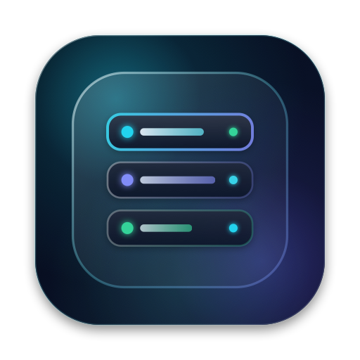
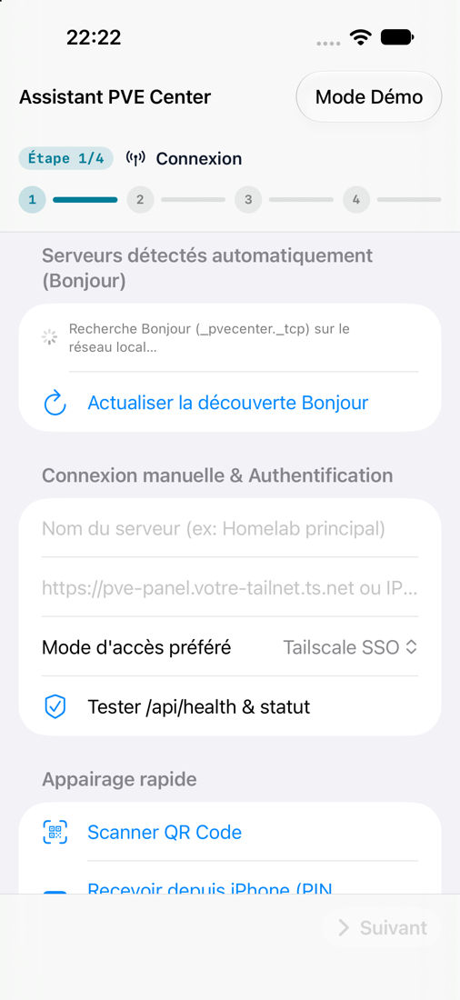
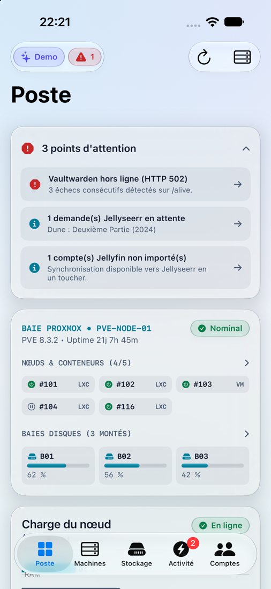
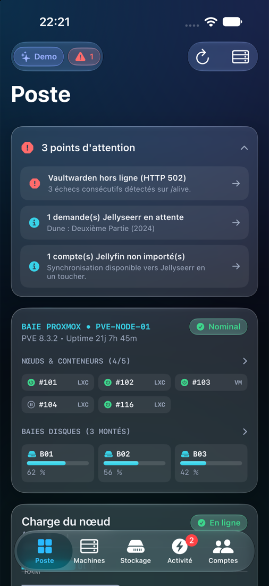
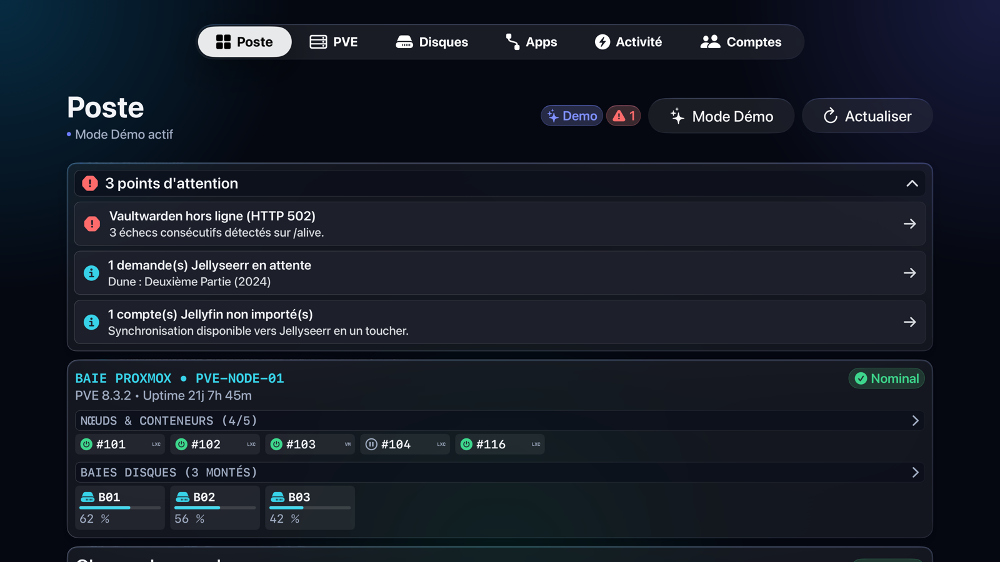
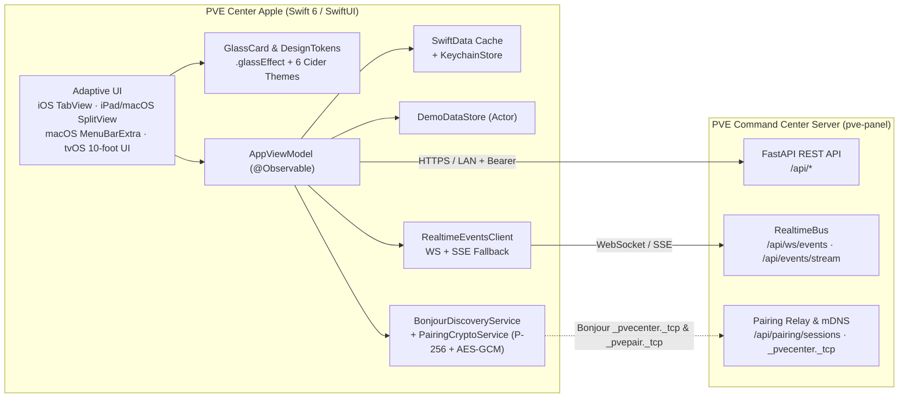

[English](README.md) | [Français](README.fr.md)

<div align="center">
  
  <h1>PVE Center for Apple</h1>
  <p>
    <strong>100% native Swift 6 &amp; SwiftUI multi-platform cockpit for Proxmox VE, homelab services, SMART/MergerFS storage, and real-time alerting across iPhone, iPad, Mac, and Apple TV.</strong>
  </p>

  <p>
    
    
    <a href="LICENSE"></a>
    
    
  </p>

  <p>
    <a href="#highlights">Highlights</a> &nbsp;·&nbsp;
    <a href="#screenshots">Screenshots</a> &nbsp;·&nbsp;
    <a href="#cider-accent-themes--liquid-glass">Cider Themes</a> &nbsp;·&nbsp;
    <a href="#architecture-overview">Architecture</a> &nbsp;·&nbsp;
    <a href="#build--install">Build &amp; Install</a> &nbsp;·&nbsp;
    <a href="#companion-repositories">Ecosystem</a>
  </p>
</div>

---

## Highlights

- **Single Universal Xcode Project (`PVECenter.xcodeproj`) & SwiftPM Package (`Package.swift`)**: Native Swift 6 strict-concurrency codebase (`io.ac.pvepanel.app`) targeting **iPhone**, **iPad**, **Mac** (not "Designed for iPad"), and **Apple TV (`tvOS`)** from one shared architecture.
- **Native Liquid Glass & Cider Studio Themes**: Built with Apple `.glassEffect(...)`, `.ultraThinMaterial`, dynamic ambient glows, WCAG contrast helpers, `reduceTransparency` / high-contrast fallbacks, and 6 Cider-inspired accent themes in both Light and Dark appearances.
- **Zero-Config Discovery & End-to-End Encrypted Apple TV Pairing**:
  - Local **Bonjour / mDNS** discovery via `Network.framework` (`_pvecenter._tcp` servers and `_http._tcp`, `_ssh._tcp`, `_smb._tcp` LAN services).
  - **QR Code** & `pvecenter://connect?...` deep-linking (`AVCaptureSession` on iOS).
  - **iPhone / Mac → Apple TV 6-digit PIN pairing**: Ephemeral **CryptoKit P-256 ECDH** + **HKDF-SHA256** + **AES-256-GCM** encrypted credential transfer over Bonjour (`_pvepair._tcp`) or HTTPS relay (`/api/pairing/sessions`).
- **macOS `MenuBarExtra` & Keyboard Workflows**: Persistent menu bar status popover showing live Proxmox node CPU/RAM, MergerFS pool usage, qBittorrent transfer speeds + Turtle mode toggle, active Jellyfin streams, and keyboard shortcuts (`⌘R`, `⌘L`, `⌘;`, `⌘1`–`⌘6`).
- **tvOS 10-Foot Experience**: Focus-engine-tuned `TVGlassCardButtonStyle` / `TVGlassPillButtonStyle`, top tab navigation, and live WebSocket/SSE alert banner overlays (`activeTVBanner`).
- **Offline Cache, Keychain Security & Full Demo Mode**: `SwiftData` caches server profiles, incidents, and services; `KeychainStore` (`kSecClassGenericPassword`) isolates API/session tokens; `DemoDataStore` provides an interactive in-memory environment for instant testing and App Store Review.

---

## Screenshots

<table>
  <tr>
    <td align="center" width="33%">
      <br />
      <sub><strong>4-Step Onboarding (iOS)</strong><br />Bonjour, QR Code, Auth &amp; Demo Mode</sub>
    </td>
    <td align="center" width="33%">
      <br />
      <sub><strong>Overview — Light Mode</strong><br />Liquid Glass, Live Alerts &amp; Proxmox Rack</sub>
    </td>
    <td align="center" width="33%">
      <br />
      <sub><strong>Overview — Dark Mode</strong><br />Deep Canvas &amp; Real-Time Telemetry</sub>
    </td>
  </tr>
</table>

<div align="center">
  <br />
  <sub><strong>Apple TV 4K (tvOS)</strong> — 10-foot Focus Engine UI, real-time alert banners, and encrypted iPhone PIN pairing.</sub>
</div>

---

## Cider Accent Themes & Liquid Glass

`PVECenter` adapts its entire canvas, ambient glows, specular borders, and pill controls to **6 `AccentTheme` presets** (`PVECenter/Models/DomainModels.swift` & `PVECenter/Views/Components/GlassCard.swift`) across **System / Light / Dark** modes:

| Theme ID | Display Name | Palette Role |
|---|---|---|
| `cyan` | **Cyan PVE** | Default PVE Signal Teal (`#38D2E8` dark / `#027C97` light) paired with Indigo accents |
| `cider` | **Cider Ruby** | Cider-inspired ruby crimson (`#FA233B` dark / `#DA1837` light) with warm magenta highlights |
| `indigo` | **Indigo Studio** | Deep studio indigo paired with cyan luminous glows |
| `emerald` | **Émeraude** | Nominal emerald green paired with teal-cyan ambient gradients |
| `amber` | **Ambre Proxmox** | Proxmox-inspired amber orange paired with crimson secondary accents |
| `purple` | **Améthyste** | Vivid amethyst purple paired with rose highlights |

Plus **28 built-in homelab service brand specs** (`ServiceBrandCatalog` in `ServiceIconView.swift`: Proxmox VE, Jellyfin, Plex, Jellyseerr, Radarr, Sonarr, Prowlarr, qBittorrent, Nextcloud, Vaultwarden, Pelican, Zoraxy, NPM, Uptime Kuma, Homepage, Freebox OS, AdGuard Home, Pi-hole, Home Assistant, Grafana, Tailscale, Cloudflare, Docker, Portainer, Immich, Traefik, Authentik, Gitea) and `Swift Charts` (`SectorMark`) storage visualizations.

---

## Architecture Overview



| Layer | Key Files |
|---|---|
| **Entry & Navigation** | `PVECenter/App/PVECenterApp.swift`, `PVECenter/App/ContentView.swift` |
| **State & Persistence** | `PVECenter/ViewModels/AppViewModel.swift`, `PVECenter/Models/DomainModels.swift`, `PVECenter/Models/SwiftDataModels.swift` |
| **Networking & Security** | `PVECenter/Services/APIClient.swift`, `KeychainStore.swift`, `RealtimeEventsClient.swift`, `BonjourDiscoveryService.swift`, `PairingCryptoService.swift`, `PushNotificationManager.swift`, `DemoDataStore.swift` |
| **Design & Feature Views** | `Views/Components/GlassCard.swift`, `ServiceIconView.swift`, `WidgetSnapshotViews.swift`, `Views/Overview/`, `Views/Proxmox/`, `Views/Storage/`, `Views/ServicesHub/`, `Views/Operations/`, `Views/Users/`, `Views/Settings/` |

See [docs/en/architecture.md](docs/en/architecture.md) for the complete technical deep-dive.

---

## Build & Install

### Prerequisites

- **macOS** with **Xcode 27+** / **Swift 6.0+** (deployment target `27.0` for iOS, macOS, and tvOS in `PVECenter.xcodeproj` and `Package.swift`).
- No third-party Swift package dependencies required (`Apple SDKs` only: `SwiftUI`, `SwiftData`, `Charts`, `CryptoKit`, `Network`, `Security`, `UserNotifications`, `AVFoundation`).

### 1. Open in Xcode

```bash
git clone https://github.com/PVE-Center/pve-center-apple.git
cd pve-center-apple
open PVECenter.xcodeproj
```

Select the **`PVECenter`** scheme (universal iOS / macOS / tvOS) or **`PVECenter-iOS`**, pick a Simulator or physical device, and press **`⌘R`**.

### 2. SwiftPM Build & Syntax Verification

```bash
swift build
bash -n scripts/*.sh
plutil -lint PVECenter/Resources/Info.plist
```

### 3. Build & Install macOS App (`/Applications/PVE Center.app`)

```bash
# Option A: Universal Xcode Release build -> /Applications/PVE Center.app
./scripts/install-mac.sh

# Option B: SwiftPM Release build + AppIcon.icns bundle -> /Applications or ~/Applications
./scripts/build-macos-app.sh
```

### 4. Launch iPhone & Apple TV Simulators

```bash
# Boot & launch on iPhone Simulator (automatically stops conflicting Apple TV simulators)
./scripts/run-iphone-sim.sh [OPTIONAL_UDID]

# Boot & launch on Apple TV 4K Simulator
./scripts/run-appletv-sim.sh [OPTIONAL_UDID]
```

### 5. Deploy to a Physical iPhone, iPad, or Apple TV

```bash
# List connected USB / Wi-Fi devices
./scripts/deploy-device.sh --list

# Build Release & install on physical iPhone / iPad
./scripts/deploy-device.sh -t <YOUR_TEAM_ID> -p ios

# Build Release & install on physical Apple TV
./scripts/deploy-device.sh -t <YOUR_TEAM_ID> -p tvos -d <APPLE_TV_UDID>
```

> **Free Apple ID & Sideloading:** Because `aps-environment` is intentionally not forced in `PVECenter.xcodeproj`, anyone can build and install on personal devices using a free Apple ID (or AltStore / SideStore / Sideloadly) while keeping real-time WebSocket/SSE alerts and local notifications active. See [docs/en/appstore-guide.md](docs/en/appstore-guide.md) for APNs `.p8` setup, TestFlight CI secrets, and sideloading instructions.

---

## Documentation & Governance

- [App Store, APNs & Sideloading Guide (EN)](docs/en/appstore-guide.md) · [Guide App Store, APNs & Sideloading (FR)](docs/fr/appstore-guide.md)
- [Apple Architecture Deep-Dive (EN)](docs/en/architecture.md) · [Architecture Apple détaillée (FR)](docs/fr/architecture.md)
- [Contributing Guide](CONTRIBUTING.md) · [Code of Conduct](CODE_OF_CONDUCT.md) · [Security Policy](SECURITY.md)

---

## Companion Repositories

`pve-center-apple` is part of the **PVE Command Center** ecosystem:

| Repository | Purpose |
|---|---|
| [**PVE-Center/pve-panel**](https://github.com/PVE-Center/pve-panel) | Core FastAPI backend, SQLite AlertEngine, mDNS publisher, embedded Web PWA, Docker & Proxmox LXC `install.sh` |
| [**PVE-Center/pve-center-apple**](https://github.com/PVE-Center/pve-center-apple) | Native Swift 6 / SwiftUI apps for iPhone, iPad, Mac & Apple TV *(this repository)* |
| [**PVE-Center/pve-center-clients**](https://github.com/PVE-Center/pve-center-clients) | Cross-platform desktop (Windows/Linux via Tauri v2) & Android (Capacitor 8) clients |
| [**PVE-Center/pve-center-website**](https://github.com/PVE-Center/pve-center-website) | VitePress bilingual showcase site & complete documentation portal |

---

## 🗺️ Roadmap

- [x] Unified Swift 6 / SwiftUI codebase across iOS, iPadOS, macOS (`MenuBarExtra`), and Apple TV (`tvOS`)
- [x] 6 Cider Studio Liquid Glass themes with dynamic canvas contrast & full accessibility fallbacks
- [x] Zero-config `_pvecenter._tcp.local.` Bonjour discovery, QR onboarding (`pvecenter://connect`), and `P-256 ECDH` Apple TV PIN pairing
- [x] Interactive Operations, unified Jellyfin/Jellyseerr user management, and declarative YAML config setup wizard
- [x] Multi-node Proxmox VE cluster node switcher (`?node=` selector, failover banner & guest node badges) synced with `pve-panel`
- [x] Glanceable WidgetKit-ready telemetry snapshot store & views (`TelemetryWidgetSnapshot`, `TelemetrySnapshotStore`, `GlanceableNodeWidgetView` for CPU/RAM gauges & active incidents)
- [ ] Automated TestFlight / App Store Connect CI distribution (requires user-provided Apple Developer signing & API secrets)

---

## License

Distributed under the [MIT License](LICENSE).
