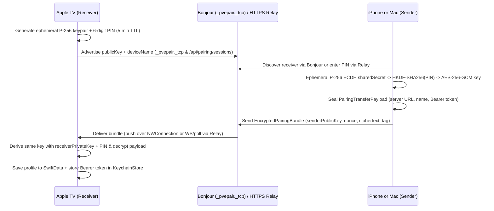

[English](../en/architecture.md) | [Français](../fr/architecture.md)

# Apple Native Architecture — PVE Center

This document explains the internal architecture of **`pve-center-apple`**, a unified Swift 6 / SwiftUI application targeting **iPhone (iOS)**, **iPad (iPadOS)**, **Mac (macOS)**, and **Apple TV (tvOS)** from one codebase.

---

## 1. Multi-Platform Target & Navigation Shell

Both `Package.swift` and `PVECenter.xcodeproj` compile the same source tree under `PVECenter/` with Swift 6 strict concurrency (`SWIFT_VERSION = 6.0`, deployment target `27.0` across iOS, macOS, and tvOS):

- **Entry Point (`PVECenter/App/PVECenterApp.swift`)**:
  - Hosts the primary `WindowGroup("PVE Center", id: "main")` scene, handles `pvecenter://` deep links via `.onOpenURL`, tracks `scenePhase` (pausing background polling and reconnecting real-time streams on foreground), and registers APNs device tokens via `PVEAppDelegate` when authorized.
  - On **macOS**, adds a `Settings` scene, a **`CommandMenu("Supervision")`** with keyboard shortcuts (`⌘R` refresh, `⌘L` live auto-refresh toggle, `⌘;` server settings, `⌘1`–`⌘6` tab switching), and a persistent **`MenuBarExtra("PVE Center", systemImage: "server.rack")`** (`MenuBarPanelView`).
- **Adaptive Root Layout (`PVECenter/App/ContentView.swift`)**:
  - **iPhone (compact horizontal size class)**: 5-tab bottom `TabView` (`AppTab.compactTabs`: `overview`, `proxmox`, `storage`, `operations`, `users`) with `.tabBarMinimizeBehavior(.onScrollDown)` and `.sensoryFeedback(...)` haptics.
  - **iPad (`regular` size class) & macOS**: `NavigationSplitView` sidebar organized into *Supervision* (`overview`, `proxmox`, `storage`, `services`) and *Administration* (`operations`, `users`) with `.searchable` toolbar filtering.
  - **Apple TV (`#if os(tvOS)`)**: Top `TabView` with a dedicated `tvOSHeaderBar` and `.preferredColorScheme(.dark)`.

---

## 2. Liquid Glass & Cider Accent Themes (`GlassCard.swift`)

`PVECenter/Views/Components/GlassCard.swift` implements a custom adaptive glass design system (`DesignTokens`, `GlassCard`, `AmbientBackgroundView`, `StatusPill`, `AppleGlassPillButtonStyle`):

- **Liquid Glass Materials**: Uses `.glassEffect(interactive ? .regular.interactive() : .regular, in: shape)` layered with `.ultraThinMaterial`, subtle theme-tinted fills, specular top-leading to bottom-trailing stroke gradients, and soft ambient elevation shadows on iOS and macOS.
- **Accessibility First**:
  - Checks `@Environment(\.accessibilityReduceTransparency)` and falls back to opaque `DesignTokens.surface(theme:colorScheme)` with sharper borders.
  - Checks `@Environment(\.colorSchemeContrast)` (`contrast == .increased`) to boost border and secondary text contrast.
  - Uses `DesignTokens.contrastingForeground(on:in:)` (WCAG relative luminance calculation) so prominent tinted buttons always pick crisp dark or white text.
- **6 Cider-Inspired `AccentTheme` Palettes** (`DomainModels.swift` + `DesignTokens`):
  - `cyan` (**Cyan PVE**), `cider` (**Cider Ruby**), `indigo` (**Indigo Studio**), `emerald` (**Émeraude**), `amber` (**Ambre Proxmox**), and `purple` (**Améthyste**).
  - Each theme defines dedicated Light & Dark values for `canvas`, `canvasSecondary`, `surface`, `surfaceElevated`, `accent`, `secondaryAccent`, and 3-point `ambientGlows` rendered in `AmbientBackgroundView`.
- **Service Brand Catalog & Charts**:
  - `ServiceIconView.swift` (`ServiceBrandCatalog`) provides 28 bespoke vector brand definitions (`jellyfin`, `plex`, `jellyseerr`, `radarr`, `sonarr`, `prowlarr`, `qbittorrent`, `nextcloud`, `vaultwarden`, `pelican`, `proxmox`, `zoraxy`, `npm`, `uptime-kuma`, `homepage`, `freebox`, `adguard`, `pihole`, `home-assistant`, `grafana`, `tailscale`, `cloudflare`, `docker`, `portainer`, `immich`, `traefik`, `authentik`, `gitea`) plus SF Symbol prefixes (`sf:...`).
  - `StorageTabView.swift` uses Apple **Swift Charts** (`SectorMark` donut charts) for MergerFS pool capacity alongside per-disk SMART diagnostics.

---

## 3. Encrypted Apple TV Pairing (`PairingCryptoService.swift`)

Setting up an Apple TV with a long HTTPS server URL and Bearer token using a Siri Remote is tedious. `PairingCryptoService` provides zero-typing end-to-end encrypted transfer from **iPhone or Mac → Apple TV**:

Cryptographic details verified in `PairingCryptoEngine` (`PVECenter/Services/PairingCryptoService.swift`):

1. **Key Agreement**: `P256.KeyAgreement.PrivateKey` (`CryptoKit`), serializing public keys in X9.63 representation (`x963Representation`).
2. **PIN-Bound KDF**: `HKDF<SHA256>` (`sharedSecret.hkdfDerivedSymmetricKey`) outputting a 256-bit (32-byte) `SymmetricKey` using:
   - `salt = "pvecenter-pairing-salt-v1:" + pinUTF8`
   - `sharedInfo = "pvecenter-pairing-aes256gcm-v1:" + pinUTF8`
3. **Authenticated Encryption**: `AES.GCM.seal` / `AES.GCM.open` over the snake-case JSON `PairingTransferPayload`.
4. **Dual Transport (`PairingTransportMode`)**:
   - **Local peer-to-peer**: `NWListener` / `NWConnection` advertising `_pvepair._tcp` via Bonjour.
   - **HTTPS Relay fallback**: `/api/pairing/sessions` on `pve-panel` (for cross-VLAN or Tailscale pairings), notified immediately via `RealtimeEventsClient` (`pairing_completed`) or 1.5s polling.

---

## 4. Persistence, Keychain & Real-Time Telemetry

- **SwiftData (`SwiftDataModels.swift`)**:
  - Models: `ServerProfileEntity`, `CachedIncidentEntity`, and `CachedCustomServiceEntity`.
  - `PVEModelContainerFactory` stores the SQLite backing store in `cachesDirectory/PVECenter-SwiftData.store` on **tvOS** (where `Application Support` is restricted) and uses the default container path on iOS/macOS, with automatic in-memory fallback on container initialization errors.
- **Keychain (`KeychainStore.swift`)**:
  - Thread-safe `Sendable` wrapper over `Security.framework` (`kSecClassGenericPassword`, service `io.ac.pvepanel.app.credentials`).
  - Isolates secrets per `profileID` UUID across `KeychainSecretKind` namespaces (`api_token`, `pairing_secret`, `proxmox_token`, `onboarding_token`, `session_token`) without requiring paid `keychain-access-groups` entitlements.
- **Bonjour mDNS (`BonjourDiscoveryService.swift`)**:
  - Uses `NWBrowser` and `NWConnection` to discover `_pvecenter._tcp` server endpoints, `_pvepair._tcp` Apple TV receivers, and general LAN services (`_http._tcp`, `_ssh._tcp`, `_smb._tcp`) with bounded scan timeouts.
- **WebSocket & SSE (`RealtimeEventsClient.swift`)**:
  - Connects to `/api/ws/events` via `URLSessionWebSocketTask`, automatically falls back to Server-Sent Events (`/api/events/stream`) if WebSocket upgrades fail, and reconnects with exponential backoff.

---

## 5. Platform-Specific Highlights

### macOS `MenuBarExtra` (`PVECenterApp.swift`)

`MenuBarPanelView` renders a 320 pt popover directly in the macOS menu bar displaying:
- Live connection / Demo status pill
- Proxmox node name, running/total VM & LXC counts, CPU % and RAM % progress bars
- MergerFS pool used/total capacity
- qBittorrent download/upload speeds and a quick **Turtle mode** (`Tortue`) toggle when available
- Active Jellyfin stream counter and **Refresh / Open Main Window / Quit** actions

### Apple TV 10-Foot UI (`ContentView.swift` & `GlassCard.swift`)

- **Focus Engine Integrity**: `TVGlassCardButtonStyle` and `TVGlassPillButtonStyle` provide dark-glass surfaces with luminous accent focus halos. Buttons in `tvOSHeaderBar` (such as *Actualiser*) use a guard instead of `.disabled(viewModel.isRefreshing)` so 5-second background refreshes never drop tvOS focus!
- **Live Alert Banners**: `PushNotificationManager` maintains `activeBannerQueue` (`activeTVBanner`) so real-time WebSocket/SSE incidents appear cleanly at the top of the TV screen with *Acknowledge*, *Mute 1h*, and *Open Details* actions.

### Demo Mode (`DemoDataStore.swift`)

`actor DemoDataStore` models a complete interactive homelab in memory (Proxmox LXC/VMs, tasks, MergerFS/SMART storage, custom services, incidents, notification channels, YAML config, and simulated pairing sessions), enabling instant UI verification without a live Proxmox host.
