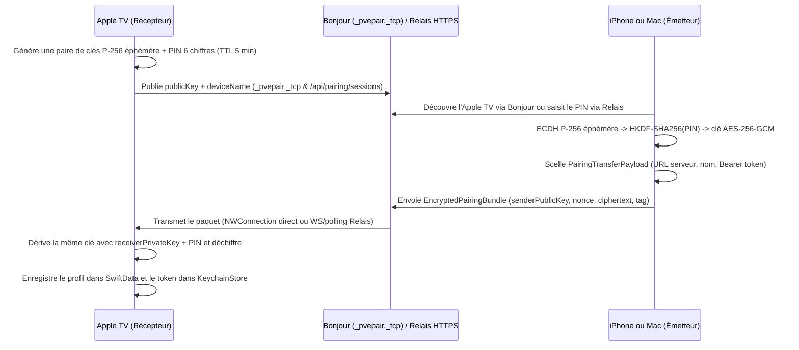

[English](../en/architecture.md) | [Français](../fr/architecture.md)

# Architecture Apple Native — PVE Center

Ce document décrit l'architecture interne de **`pve-center-apple`**, une application unifiée en Swift 6 et SwiftUI ciblant **iPhone (iOS)**, **iPad (iPadOS)**, **Mac (macOS)** et **Apple TV (tvOS)** depuis une base de code unique.

---

## 1. Cible multi-plateformes & Structure de navigation

`Package.swift` et `PVECenter.xcodeproj` compilent la même arborescence sous `PVECenter/` avec la concurrence stricte Swift 6 (`SWIFT_VERSION = 6.0`, cible de déploiement `27.0` sur iOS, macOS et tvOS) :

- **Point d'entrée (`PVECenter/App/PVECenterApp.swift`)** :
  - Déclare la scène principale `WindowGroup("PVE Center", id: "main")`, traite les liens profonds `pvecenter://` via `.onOpenURL`, suit `scenePhase` (suspension en arrière-plan et reprise temps réel au retour au premier plan) et enregistre le jeton APNs via `PVEAppDelegate` lorsqu'il est autorisé.
  - Sur **macOS**, ajoute une scène `Settings`, un menu **`CommandMenu("Supervision")`** avec raccourcis clavier (`⌘R` rafraîchir, `⌘L` pause/reprise auto-refresh 5s, `⌘;` réglages serveur, `⌘1`–`⌘6` navigation par onglet), et un menu persistant **`MenuBarExtra("PVE Center", systemImage: "server.rack")`** (`MenuBarPanelView`).
- **Interface adaptative (`PVECenter/App/ContentView.swift`)** :
  - **iPhone (largeur compacte)** : `TabView` inférieure limitée à 5 onglets (`AppTab.compactTabs` : `overview`, `proxmox`, `storage`, `operations`, `users`) avec `.tabBarMinimizeBehavior(.onScrollDown)` et retours haptiques `.sensoryFeedback(...)`.
  - **iPad (`regular`) & macOS** : `NavigationSplitView` avec barre latérale structurée en *Supervision* (`overview`, `proxmox`, `storage`, `services`) et *Administration* (`operations`, `users`), plus champ `.searchable` dans la barre d'outils.
  - **Apple TV (`#if os(tvOS)`)** : `TabView` supérieure accompagnée d'une `tvOSHeaderBar` dédiée et forcée en mode sombre (`.preferredColorScheme(.dark)`).

---

## 2. Liquid Glass & Thèmes Cider (`GlassCard.swift`)

`PVECenter/Views/Components/GlassCard.swift` implémente le système de design verre adaptatif (`DesignTokens`, `GlassCard`, `AmbientBackgroundView`, `StatusPill`, `AppleGlassPillButtonStyle`) :

- **Matériaux Liquid Glass** : combine `.glassEffect(interactive ? .regular.interactive() : .regular, in: shape)` et `.ultraThinMaterial`, avec voiles colorés par le thème actif, bordures dégradées spéculaires et ombres douces sur iOS et macOS.
- **Accessibilité native** :
  - Respecte `@Environment(\.accessibilityReduceTransparency)` en basculant sur des surfaces opaques `DesignTokens.surface(theme:colorScheme)` aux bordures nettes.
  - Détecte `@Environment(\.colorSchemeContrast)` (`contrast == .increased`) pour renforcer les bordures et textes secondaires.
  - Calcule automatiquement le premier plan via `DesignTokens.contrastingForeground(on:in:)` (luminance relative WCAG) pour garantir la lisibilité sur chaque bouton coloré.
- **6 thèmes d'accentuation `AccentTheme` inspirés de Cider** (`DomainModels.swift` + `DesignTokens`) :
  - `cyan` (**Cyan PVE**), `cider` (**Cider Ruby**), `indigo` (**Indigo Studio**), `emerald` (**Émeraude**), `amber` (**Ambre Proxmox**) et `purple` (**Améthyste**).
  - Chaque thème définit des couleurs Clair et Sombre dédiées pour `canvas`, `canvasSecondary`, `surface`, `surfaceElevated`, `accent`, `secondaryAccent` et les 3 halos de `ambientGlows` dans `AmbientBackgroundView`.
- **Catalogue d'icônes homelab & Graphiques** :
  - `ServiceIconView.swift` (`ServiceBrandCatalog`) embarque 28 définitions vectorielles (`jellyfin`, `plex`, `jellyseerr`, `radarr`, `sonarr`, `prowlarr`, `qbittorrent`, `nextcloud`, `vaultwarden`, `pelican`, `proxmox`, `zoraxy`, `npm`, `uptime-kuma`, `homepage`, `freebox`, `adguard`, `pihole`, `home-assistant`, `grafana`, `tailscale`, `cloudflare`, `docker`, `portainer`, `immich`, `traefik`, `authentik`, `gitea`) ainsi que les préfixes SF Symbols (`sf:...`).
  - `StorageTabView.swift` utilise **Swift Charts** (`SectorMark`) pour représenter l'occupation du pool MergerFS en complément de la télémétrie SMART des disques.

---

## 3. Appairage Apple TV chiffré (`PairingCryptoService.swift`)

Saisir une URL HTTPS et un long Bearer token à la télécommande Siri Remote étant fastidieux, `PairingCryptoService` assure le transfert chiffré de bout en bout **iPhone / Mac → Apple TV** :

Détails cryptographiques vérifiés dans `PairingCryptoEngine` (`PVECenter/Services/PairingCryptoService.swift`) :

1. **Échange de clés** : `P256.KeyAgreement.PrivateKey` (`CryptoKit`), sérialisation des clés publiques au format X9.63 (`x963Representation`).
2. **Dérivation liée au PIN** : `HKDF<SHA256>` (`sharedSecret.hkdfDerivedSymmetricKey`) produisant une clé symétrique 256 bits (32 octets) avec :
   - `salt = "pvecenter-pairing-salt-v1:" + pinUTF8`
   - `sharedInfo = "pvecenter-pairing-aes256gcm-v1:" + pinUTF8`
3. **Chiffrement authentifié** : `AES.GCM.seal` / `AES.GCM.open` sur la charge JSON `PairingTransferPayload` (clés `snake_case`).
4. **Double transport (`PairingTransportMode`)** :
   - **Pair-à-pair local** : `NWListener` / `NWConnection` publiant `_pvepair._tcp` via Bonjour.
   - **Repli Relais HTTPS** : `/api/pairing/sessions` sur `pve-panel` (utile entre VLANs ou via Tailscale), avec notification temps réel `pairing_completed` via `RealtimeEventsClient` ou interrogation toutes les 1,5 s.

---

## 4. Persistance, Keychain & Télémétrie temps réel

- **SwiftData (`SwiftDataModels.swift`)** :
  - Modèles : `ServerProfileEntity`, `CachedIncidentEntity` et `CachedCustomServiceEntity`.
  - `PVEModelContainerFactory` stocke la base SQLite dans `cachesDirectory/PVECenter-SwiftData.store` sur **tvOS** (où `Application Support` est restreint) et utilise le chemin standard sur iOS/macOS, avec bascule automatique en mémoire en cas d'erreur d'initialisation.
- **Keychain (`KeychainStore.swift`)** :
  - Wrapper `Sendable` autour de `Security.framework` (`kSecClassGenericPassword`, service `io.ac.pvepanel.app.credentials`).
  - Isole chaque secret par UUID de profil et `KeychainSecretKind` (`api_token`, `pairing_secret`, `proxmox_token`, `onboarding_token`, `session_token`) sans nécessiter d'entitlement payant `keychain-access-groups`.
- **Bonjour mDNS (`BonjourDiscoveryService.swift`)** :
  - Utilise `NWBrowser` et `NWConnection` pour découvrir les serveurs `_pvecenter._tcp`, les récepteurs `_pvepair._tcp` et les services LAN (`_http._tcp`, `_ssh._tcp`, `_smb._tcp`) avec délai borné.
- **WebSocket & SSE (`RealtimeEventsClient.swift`)** :
  - Se connecte à `/api/ws/events` via `URLSessionWebSocketTask`, bascule automatiquement sur Server-Sent Events (`/api/events/stream`) si nécessaire et se reconnecte avec backoff exponentiel.

---

## 5. Spécificités par plateforme

### MenuBarExtra macOS (`PVECenterApp.swift`)

`MenuBarPanelView` affiche un popover de 320 pt directement dans la barre des menus macOS contenant :
- Pastille d'état en direct / Mode Démo
- Nom du nœud Proxmox, compteurs LXC/VM actifs et barres de progression CPU % / RAM %
- Capacité utilisée / totale du pool MergerFS
- Débits descendant/montant qBittorrent et bouton **Mode Tortue** (`Tortue`) lorsque disponible
- Compteur de flux Jellyfin actifs et boutons **Actualiser / Ouvrir / Quitter**

### Interface 10-foot Apple TV (`ContentView.swift` & `GlassCard.swift`)

- **Stabilité du Focus Engine** : `TVGlassCardButtonStyle` et `TVGlassPillButtonStyle` offrent des surfaces sombres contrastées et un halo de focus lumineux. Les boutons de `tvOSHeaderBar` (comme *Actualiser*) utilisent une garde logique au lieu de `.disabled(viewModel.isRefreshing)` afin que le rafraîchissement automatique toutes les 5 s ne fasse jamais perdre le focus à la télécommande.
- **Bannières d'alerte en direct** : `PushNotificationManager` gère la file `activeBannerQueue` (`activeTVBanner`) pour afficher les incidents WebSocket/SSE en haut de l'écran TV avec les actions *Acquitter*, *Mute 1h* et *Détails*.

### Mode Démo (`DemoDataStore.swift`)

L'acteur `DemoDataStore` simule un homelab interactif complet en mémoire (LXC/VMs Proxmox, tâches, stockage MergerFS/SMART, services personnalisés, incidents, canaux de notification, configuration YAML et sessions d'appairage), permettant d'explorer et de tester l'application instantanément sans serveur Proxmox actif.
